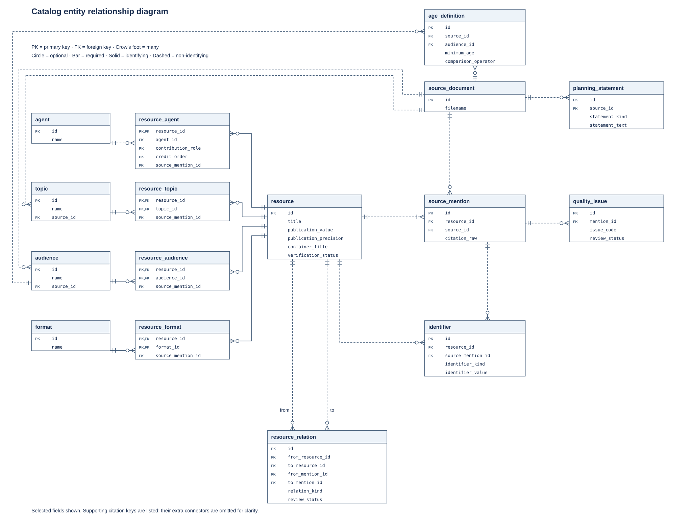
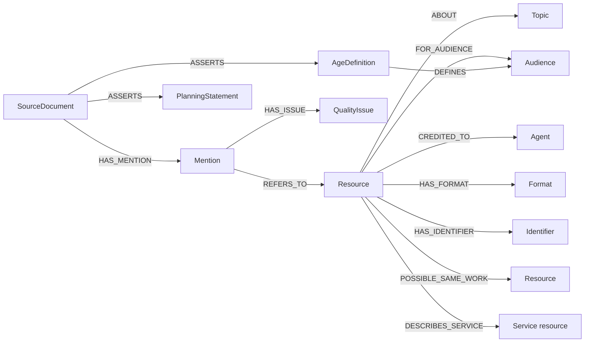

# Analysis of VPL-1_resources.pdf

## Recommendation

Use MySQL as the main catalog database. Store resources, topics, audiences, contributors, formats, and citations in separate tables. Link them by ID. Keep the original PDF, its file hash, and each citation's page number.

The PDF describes a library resource collection that needs editing, search, filters, and reports. Neo4j is useful for exploring connections between resources. The prototype lets you try either database. A database of fraud cases, victims, transactions, or user accounts would need a separate design.

## What the PDF contains

Pages 1–2 describe suggested audiences, topics, goals, and activities. Pages 2–5 list resources. The PDF summarizes student suggestions but gives no student counts or ratings. The number of mentions does not show popularity, quality, or how common fraud is.

| Source category | Mentions |
| --- | ---: |
| Main bibliography | 32 |
| Videos | 13 |
| Podcasts | 1 |
| Websites | 1 |
| Hotlines | 1 |
| Fliers & Written Resources | 2 |
| **Total** | **50** |

Bibliography entry #22 and the Websites entry name the same National Elder Fraud Hotline webpage. They share one record, giving **49 records** in total. Both citations keep their access dates: September 23 and September 19, 2026. The telephone service has its own record linked to the webpage.

An extra passage in the hotline section mentions virtual assistants, call-blocking apps, and Dow Jones. It is saved as a separate note because it does not clearly identify another resource.

| Suggested format | Records |
| --- | ---: |
| Video | 12 |
| Web resource | 9 |
| Book | 8 |
| Journal article | 8 |
| News article | 2 |
| Flyer | 2 |
| Unknown | 2 |
| Brochure, fact sheet, journal, presentation collection, podcast, hotline service | 1 each |

The source heading and suggested format are stored separately. Two entries under Videos link to O'Reilly and ClinicalKey library content; their formats remain unknown. The main bibliography also includes a TED video. This gives 12 suggested videos, all still needing review.

**37 records have URLs**, including **7 with DOIs**. One record has a phone number, and **11 have no link or number**. **35 have publication dates**, some with only a year or month; **14 are undated**. These counts are in [data/profile.json](../data/profile.json). The citations have not been checked against other sources.

## Data issues

- The PDF uses 55+, 60+, 65+, and over 65 to define “elder.” Each definition is kept with its source. No single age rule has been chosen. Hotline eligibility also needs checking.
- Freeman's title ends in “— Large,” and one flyer title ends in “Flye.” The original wording is kept and flagged for review.
- The AARP shopping-scam video has no usable URL. Many books have no ISBN. Missing details stay empty.
- The ClinicalKey link uses a university proxy. Its broken lines were joined and a trailing backslash removed. One YouTube link had `https://` added. The original text and cleanup notes are kept.
- The Jane Walsh TED entries may describe the same talk, but their dates differ. They stay separate, linked by `possible_same_work`. The romance and Illinois flyers also remain possible matches.
- “Independently published” is kept as a statement. People and organizations have separate credit types. Matching names have not been checked against outside records.
- Titles and publication dates, including 2026 dates, were copied from the PDF. Access dates are stored separately. They do not show when a resource was published or checked.
- Topic and audience labels are suggestions with a reason and review status. The older-adult tag shows the collection's intended audience; suitability and accessibility still need checking.

Six requested topics have no specifically tagged resource: grandchild scams, tech-support scams, government impersonation, credit-card fraud, mail fraud, and tax assistance. General resources may cover them, so read the resources before calling these true gaps. Captions, large print, reading level, language, access limits, and service details also need checking.

## MySQL design

| Tables | Contents |
| --- | --- |
| `source_document` | Filename, PDF and text file hashes, page count, import date |
| `resource` | ID, title, publication date and detail level, journal or series, publisher statement, check status |
| `source_mention` | Each citation's category, list position, pages, original text, and access date |
| `agent`, `resource_agent` | People and organizations, their roles, and credit order |
| `format`, `resource_format` | Suggested formats and the citations that support them |
| `topic`, `resource_topic` | Topic list and suggested resource labels |
| `audience`, `resource_audience` | Audience list and suggested resource labels |
| `identifier` | URL, DOI, or phone number and its source citation |
| `quality_issue` | Citation problems and their review status |
| `resource_relation` | Possible duplicates and links from webpages to services |
| `planning_statement` | Original audience, topic, and goal notes, plus the extra passage |
| `age_definition` | Age limit, whether it includes that age, source, and review status |

[Open the full-size ER diagram](diagrams/er-catalog.svg) to zoom in on individual tables.

The layout is maintained in [diagrams/render_er.py](diagrams/render_er.py). Regenerate the SVG with `python3 docs/diagrams/render_er.py`.

Records have fixed IDs within this dataset. Database rules prevent duplicate identifiers and links to missing records. They also check that a label's source citation belongs to the same resource. Credits keep their original order.

URLs keep their letter case and query parameters. YouTube's `v` parameter identifies the video. DOIs use lowercase for matching; the original spelling stays in the citation.

Dates keep the detail supplied: `2026`, `2026-03`, or `2026-03-12`. A separate field records that detail level. Missing days are never guessed. Complete access and import dates use SQL `DATE`. Python checks calendar dates; SQL checks that the stored value matches the stated detail level. Separate year, month, and day fields can be added later if reports need them.

The MySQL setup uses InnoDB, `utf8mb4` text, and indexes for common searches. Foreign keys check that linked records exist. [MySQL foreign-key documentation](https://dev.mysql.com/doc/refman/8.4/en/create-table-foreign-keys.html)

Authors, topics, and links use separate rows so they are easy to search and check. MySQL supports JSON for extra details, but this prototype needs no JSON column. [MySQL JSON documentation](https://dev.mysql.com/doc/refman/8.4/en/json.html)

FULLTEXT searches titles and citations. It does not search the linked books, articles, or videos. Word-splitting rules and ignored common words can affect results. [MySQL FULLTEXT documentation](https://dev.mysql.com/doc/refman/8.4/en/fulltext-search.html)

## Neo4j design

Neo4j stores resources, citations, sources, contributors, topics, audiences, formats, identifiers, issues, notes, and age definitions as nodes. Links connect them:

Topic and audience links keep a reason, review status, and source citation ID. Credit links keep role and order. Possible duplicate links keep the evidence. Both databases use the same resource IDs and citations. You can inspect the graph in `build/graph.json` without running Neo4j.

The import creates rules to prevent duplicate IDs, then uses `MERGE` to add or update nodes. It finds both nodes before linking them. The rules are needed because `MERGE` alone cannot prevent duplicate nodes when writes happen at the same time. [Neo4j MERGE documentation](https://neo4j.com/docs/cypher-manual/current/clauses/merge/)

This setup uses Neo4j 5 Community Edition. Rules for required fields, data types, and node keys need Enterprise Edition, so the importer must check these itself. Community Edition also needs application checks for source links and allowed relationships. [Neo4j constraints documentation](https://neo4j.com/docs/cypher-manual/5/constraints/)

Dates use the same text format as the shared dataset. Complete dates could use Neo4j's `date` type later. The import uses standard Cypher 5 with no plugins. Text search uses `db.index.fulltext.queryNodes`. Its ranking scores differ from MySQL's. [Neo4j full-text documentation](https://neo4j.com/docs/cypher-manual/5/indexes/search-indexes/full-text-indexes/)

## Comparison

| Task | MySQL | Neo4j |
| --- | --- | --- |
| Edit catalog details | Tables with database rules | Nodes and links with importer checks |
| Filter by topic, format, or audience | Join linked tables | Match connected nodes |
| Keep author order and publisher roles | Credit rows | Details on credit links |
| Find shared topics | Match resources through the topic table | Follow resource → topic ← resource |
| Track sources and possible duplicates | Citation, issue, and link tables | Citation and issue nodes with links |
| Explore several steps of connections | More joins or recursive queries | Follow paths of different lengths |
| Count resources and write reports | Grouped SQL queries | Graph count queries |
| Run and maintain | One main catalog database | Extra sync and backup work if used alongside MySQL |

Both can answer the example questions. These comparisons describe how the designs work; speed has not been measured. The dataset is too small to show which database handles large collections better. Shared topics show a connection, but do not prove quality, accessibility, or suitability.

The prototype includes table and graph rules, sample data, and the same searches for both databases. MySQL imports add or update records using row aliases, as recommended in place of the older `VALUES(column)` syntax. [MySQL upsert documentation](https://dev.mysql.com/doc/refman/8.4/en/insert-on-duplicate.html)

## Import steps

1. Save the PDF and its file hash. Extract the text with page breaks.
2. Save every citation before checking for duplicates. Keep the source heading and suggested format separate.
3. Clean only clear date and link issues. Merge the repeated URL and keep uncertain matches separate.
4. Add resource details and suggested labels with their sources. Save planning notes separately.
5. Check dates, duplicate identifiers, and source links. Load records before linking them.
6. Review incomplete citations, formats, possible duplicates, links, and service details before publishing recommendations.

## Future work

The importer is written for this PDF and uses manually copied details. IDs apply only to this dataset. Each resource can have one current label for a given topic or audience. To keep several reviewers' views or past decisions, add review records with reviewer, date, and source.

Before regular imports, add database change tracking, source versions, and a review history. If both databases are used, copy approved changes through a reliable queue and check that they stay in sync. The prototype builds both from the same dataset; it does not sync live changes.

Later tables could store access rules, language, location, licenses, captions, large print, service hours, and eligibility. Keep these unknown until checked. Add tables for related editions or recordings if needed. Classes and partnerships would need program and session tables once actual dates are available.

## Checks and limits

**21 local Python/SQLite tests passed.** They check the 50 mentions and 49 records, source pages, access dates, partial dates, unknown formats, URL fixes, age definitions, author order, repeat imports, search, rejected tags, database rules, and matching graph results.

`docker compose config --quiet` passed. The Docker engine was unavailable, so the **six MySQL and Neo4j tests have not been run**. They load data twice, check counts, run example searches, and test database rules. Speed has not been tested. See [the README](../README.md) for commands.

The database research used the linked official documentation on October 21, 2026. The citations, contributor details, website links, accessibility, and service details copied from the PDF still need checking.
