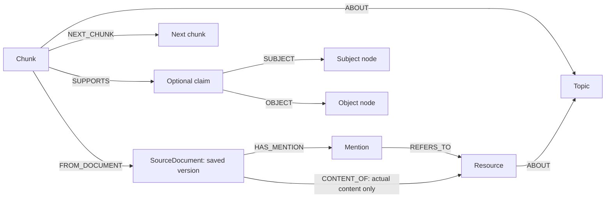

I reviewed the five-page PDF and built a database prototype for its resource collection. The PDF has 50 resource mentions. One website appears twice, giving 49 catalog records. All 50 original mentions are kept. The PDF also describes audiences, topics, goals, and possible library activities. It does not provide individual student records or ratings.

The data includes incomplete titles, missing links, possible duplicates, and different age definitions for “elder.” I kept the original citations and page references for later checks. Uncertain matches stay separate. Topic and audience labels are marked as proposed because the resources still need full review.

The MySQL design separates different types of information and values that can repeat. A resource can have several authors, topics, audiences, formats, or links. A single large row would repeat details or need lists inside fields. Separate tables make each value easier to search, change, and check.

| Design choice | Reason |
| --- | --- |
| Separate `resource` and `source_mention` tables | One resource can appear several times. Each citation keeps its own wording, page, category, and access date. |
| Separate `agent` and `resource_agent` tables | The same person or organization can contribute to several resources. The link keeps the role and author order. |
| Separate topic, audience, and format tables | Shared labels make filters consistent. Link tables allow several labels per resource. |
| Separate `identifier` table | A resource can have a URL, DOI, or phone number. Each identifier keeps its source. |
| Separate `quality_issue` and `resource_relation` tables | Missing details and possible duplicates can be checked without losing records or merging them too soon. |
| Separate `planning_statement` and `age_definition` tables | Collection ideas and conflicting age rules stay separate from resource details. |

For example, the hotline webpage appears in the bibliography and the Websites section. Both mentions point to the same resource, but keep their different access dates. The telephone service has its own record because it differs from the page describing it. Similar titles alone are not enough to merge records.

Fixed IDs connect the tables. Foreign keys check that linked records exist. Other rules check that a label's source citation belongs to the same resource, preventing evidence from being attached to the wrong record. Unique identifier rules help prevent duplicate entries. These checks support ongoing catalog editing. [MySQL foreign-key documentation](https://dev.mysql.com/doc/refman/8.4/en/create-table-foreign-keys.html)

The date fields keep the detail supplied. A year stays `2026`; a month stays `2026-03`. A separate field records whether the date includes a year, month, or day. This avoids guessing January 1 for an unknown date. Access dates stay separate from publication dates. Python checks real calendar dates; the SQL rules check the stored date's length and detail level.

Indexes support common filters, such as topic, format, audience, and publication date. Full-text search covers titles and citation text. It does not search the contents of the linked books, articles, or videos. This is a useful first design because the current data is mainly a catalog.

**MySQL schema.** The schema has 16 tables. `resource` is the main table, and IDs connect it to source records and other details. The tables are defined in [elder_catalog/schema.py](elder_catalog/schema.py).

| Tables | Main fields and links |
| --- | --- |
| `resource` | ID, title, publication date and its detail level, journal or series, publisher statement, citation text, and check status. |
| `source_document`, `source_mention` | Source filename, file hashes, and import date; each mention links a resource to its source and keeps the original text, pages, category, and access date. |
| `agent`, `resource_agent` | Contributor names and person or organization type; links store each contributor's role, credit order, and source citation. |
| `topic`, `audience`, `format` | Shared lists of topics, reader groups, and media types. |
| `resource_topic`, `resource_audience`, `resource_format` | Resource IDs, label IDs, and source citation IDs. Topic and audience links also keep a reason and review status; format links keep a reason. |
| `identifier` | Resource ID, identifier type and value: URL, DOI, or phone number, plus its source citation. |
| `quality_issue`, `resource_relation` | Citation problems and links between resources, with evidence and review status. |
| `planning_statement`, `age_definition` | Collection notes and proposed age limits, each linked to its source. |

One resource can have many citations and contributors. Link tables let a resource have several topics, audiences, or formats. Each label can apply to many resources.

Neo4j stores resources, topics, audiences, contributors, formats, citations, and sources as nodes. Named links connect them. For example, a resource has an `ABOUT` link to a topic and a `CREDITED_TO` link to a contributor. Shared topics are nodes so queries can find resources connected through them.

This supports questions such as “Which resources share a topic with this video?” A query follows resource → topic ← resource. Credits keep their role and order on the link. Topic and audience links keep their reason, review status, and source citation ID. Separate `Mention` nodes preserve each original citation. `POSSIBLE_SAME_WORK` links flag uncertain matches without treating them as confirmed duplicates.

Neo4j uniqueness rules protect IDs, and `MERGE` adds or updates records using those IDs. The prototype uses Neo4j 5.26 Community Edition. That edition supports uniqueness rules, while rules for required properties, property types, and node keys require Enterprise Edition. The importer must check details that the graph database does not enforce. [Neo4j 5 constraints](https://neo4j.com/docs/cypher-manual/5/constraints/)

For an LLM using retrieval-augmented generation, or RAG, I recommend extending this graph. RAG finds relevant stored information and gives it to the model to help write an answer. The existing graph can help the model find and describe resources. It cannot support detailed claims about a book or video whose contents have not been collected. A bibliography entry shows that a resource was listed. It does not support every claim in that resource.

The most useful next step is to add source text and links to exact passages. Keep the current catalog nodes, then add `Chunk` nodes containing short text passages. Each chunk should point to the exact saved source version and record its page, section, or video timestamp. Links between neighboring chunks let a search include nearby context. Neo4j's graph-building tools support document nodes, text chunks, and links between neighboring chunks. [Neo4j knowledge graph builder](https://neo4j.com/docs/neo4j-graphrag-python/current/user_guide_kg_builder.html)

The following is a proposed extension. It has not been implemented:

Here, each `SourceDocument` represents one saved version, identified by its content hash. Several versions can belong to the same resource. The original planning PDF remains a source of catalog citations. Only an actual article, book extract, webpage, or transcript gets a `CONTENT_OF` link to that resource. This keeps student suggestions from being used as evidence for advice that was never read.

| Proposed item | Details to store | Why it helps |
| --- | --- | --- |
| Saved `SourceDocument` | Source URL or path, content hash, fetch date, publication date if known, source kind, access rules, and review status | Shows which version supplied the evidence and whether it may be used. |
| `Chunk` | ID, exact text, order, source ID, page or timestamp, text hash, and evidence kind | Lets an answer cite the passage it used. Evidence kind separates a citation from full text or a transcript. |
| Chunk embedding | Text vector, model name and version, vector size, and date created | Supports search by meaning and shows when vectors need rebuilding. |
| Optional `Claim` | Subject, named relation, object, supporting passage, extraction method, model version, and review status | Lets reviewers check extracted statements and keeps conflicting statements separate. |

Start with whole citations and complete planning paragraphs from the PDF. For longer documents, split at headings and paragraph boundaries. Try 300–600 tokens per chunk with a small overlap, then test that setting. It is not a fixed rule. Keep page ranges and transcript timestamps. Collect linked content only when access allows it. Record which resources remain unavailable.

Use a fixed list of node and link types when extracting information. To answer questions about scam types, warning signs, and support services, add those types after collecting supporting text. Avoid creating a node for every word. Keep simple details, such as a publication year, as properties.

A claim node helps when sources disagree or a statement needs review. For example, the different age definitions should keep their own source passages and statuses. Each claim needs clear text, a subject, a relation, and an object. An LLM confidence score would not replace evidence or review. Keep the existing direct topic links for simple catalog searches.

I would avoid automatically merging records based only on names. Two people can share a name, and the same work can have several versions. Neo4j's graph builder can merge matching labels and names by default; that step can be disabled. Its knowledge-building pipeline is still marked experimental. Use a fixed package version and test its output before regular imports. [Neo4j graph builder settings](https://neo4j.com/docs/neo4j-graphrag-python/current/user_guide_kg_builder.html)

An LLM does not require Neo4j. MySQL queries can also supply catalog records and stored passages to it. I would add the graph for questions that need links across sources. Simpler catalog questions can stay in MySQL.

For retrieval, I recommend combining three methods:

| Method | Use |
| --- | --- |
| Structured query | Exact questions about dates, formats, counts, authors, or catalog records. |
| Keyword and vector search | Exact names and terms, plus passages with similar meaning in different words. |
| Short graph searches | Add related topics, source details, approved claims, or neighboring passages after finding a good match. |

Neo4j's `HybridCypherRetriever` combines vector and full-text search, then runs a graph query to collect more context. This fits the proposed chunk model. The current library does not offer its usual metadata filter option for hybrid retrievers. Add required filters to the retrieval query or a separate search flow. [Neo4j RAG guide](https://neo4j.com/docs/neo4j-graphrag-python/current/user_guide_rag.html)

The prototype's Neo4j 5.26 supports vector indexes. An embedding is a list of numbers that represents text. Store one on each chunk and create a vector index whose size matches the chosen embedding model. Embed questions with the same model. Different models must use separate properties or indexes, even if their vector sizes match. On this server version, vector search can use `db.index.vector.queryNodes`; newer documentation also describes features that need newer servers. [Neo4j 5 vector indexes](https://neo4j.com/docs/cypher-manual/5/indexes/semantic-indexes/vector-indexes/)

Next Step:

1. Use a fixed query for exact catalog questions. Search source passages for questions that need them.
2. Find keyword and vector matches, then combine their ranks. Do not simply add their raw scores.
3. Check access rules, source version, evidence kind, and review status before passing text to the model. If full text is required, exclude chunks that contain only citations.
4. Expand only useful links, normally one or two steps. Include nearby text when it clarifies a passage. Broad topics can connect many weak matches, so set result and length limits.
5. Remove repeated passages, rank the evidence, and return a small set of passages with source titles, URLs, pages or timestamps, and review status.
6. Ask the model to answer from the evidence, cite sources, and say when the stored information is not enough. Treat retrieved text as source material, not as instructions to the model.

